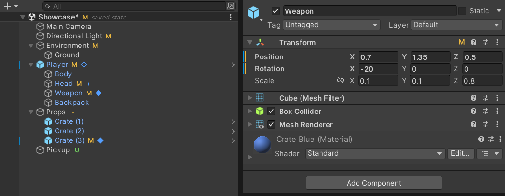
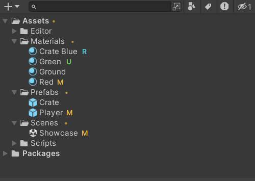
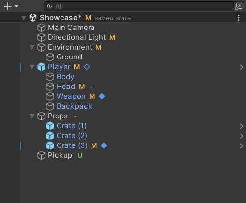
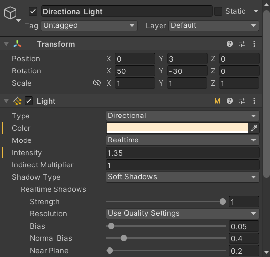
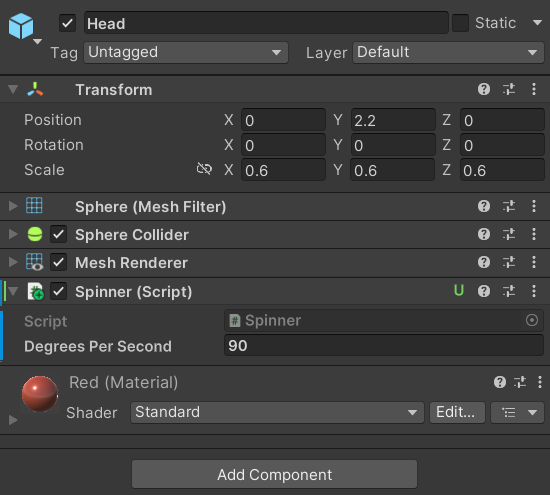

# Git Status Overlay

Editor-only Unity tool that shows git status inside the editor, like VS Code's U/M/D markers:
in the Project window, in the Hierarchy (down to the changed GameObject, even inside prefab instances) and in the
Inspector (down to the changed property). It also shows prefab overrides directly in the Hierarchy.
It has no dependencies: it runs `git` from PATH in the background and never changes the project.



*In this sample scene, the Player's weapon was moved (a prefab-instance override, shown with Unity's blue bar and the
overlay's amber git bar), a component was added to its head, a crate was rescaled, the light was changed and a
pickup was added. The scene also has unsaved edits, hence the "saved state" hint.*

## Install

**[Add to VCC / ALCOM](https://gnimrodg.github.io/unity-git-status-overlay/)** (one click on that page), or add the
repository by hand in ALCOM or the VRChat Creator Companion under **Settings → Packages → Add Repository**:

```
https://raw.githubusercontent.com/GNimrodG/unity-git-status-overlay/vpm/index.json
```

Then add **Git Status Overlay** to your project. Without VCC, download the zip from the
[latest release](https://github.com/GNimrodG/unity-git-status-overlay/releases/latest) and extract it into
`Packages/com.data-unknown.git-status-overlay/` in your project.

Requirements: Unity 2022.3 or Unity 6.0 (tested with 2022.3.22f1 and 6000.0.67f1), `git` on PATH, a project inside a git repository. If an older copy lives in
`Assets/GitStatusOverlay`, installing the package removes it.

## Project window



A letter after each changed asset's name (or at the top-right corner of a thumbnail in icon view):

| Mark | Colour | Meaning |
|---|---|---|
| `U` | green | untracked |
| `A` | green | added (staged new file) |
| `M` | amber | modified (also a submodule with changes inside) |
| `R` | teal | renamed (tooltip: old path) |
| `!` | pink | merge conflict |
| `•` | amber or red | folder with changes inside (red: only deletions) |

- An asset and its `.meta` count as one item. The tooltip says when only the `.meta` changed.
- Deleted files have no item to draw on. They are listed in the tooltip of the nearest folder that still exists.
  A deleted folder is shown as one line (`name/ (N files)`).
- Files inside dirty submodules get their own markers. The tool runs a second `git status` inside the submodule.
- Paths with spaces, brackets and non-ASCII characters work: the tool uses `git status --porcelain=v2 -z`.

## Hierarchy window



**Git changes in open scenes and the open prefab.** Only `.unity` and `.prefab` files that git sees as modified or untracked are checked.
For those, the tool compares the saved file with `HEAD` (`git diff -U0 HEAD` plus `git show HEAD:<file>`).
It maps each changed line to its YAML document (`--- !u!<classId> &<fileID>`), then to the live object through `GlobalObjectId`:

- `M` on a GameObject when its own block or one of its components changed. The tooltip lists which (`MeshRenderer changed`, `+ BoxCollider added`, …).
- `U` on GameObjects whose blocks are new. In an untracked file, every object is new.
- `•` on ancestors that contain changed objects.
- **Prefab instances**: changes in the `PrefabInstance` block (`m_Modifications`, `m_AddedComponents`, `m_AddedGameObjects`, `m_RemovedComponents`, …) are resolved through each entry's `target` to the actual child.
  For example, `override SkinnedMeshRenderer.m_Materials.Array.data[0]` marks the child that owns the renderer, and the instance root gets an `M` too.
  The source prefab names removed components and objects.
- **Scene row**: the file letter. Its tooltip gives counts and lists deleted objects (e.g. `GameObject 'Old Light'`, `BoxCollider on 'Floor'`).
  It also counts blocks that can't be shown (scene settings).
  In prefab mode the prefab root row carries the file letter in brackets (`[M]`).
- **Unsaved changes**: only the saved file is compared. While the scene or prefab is dirty, the row shows a grey *saved state* hint.

**Prefab overrides** (separate from git, blue): objects that differ from their source prefab, like Unity's blue override bar.

| Glyph | Meaning |
|---|---|
| `◆` | property overrides (tooltip: component and property paths, capped) |
| `+` | added GameObject or added components only |
| `−` | removed components only |
| `◇` | instance root without own overrides (tooltip: how many objects inside are overridden) |

Default overrides (root position/rotation/name) are ignored, as in Unity's Overrides dropdown.

## Inspector

Changed properties are marked in the Inspector, for scene and prefab-mode objects and for modified assets selected in the Project window (materials, prefabs, ScriptableObjects, controllers, …):

- **Property bar**: an amber bar in the left gutter, next to Unity's blue prefab-override bar, on each property that changed vs HEAD.
  The tooltip shows the change, e.g. `m_LocalPosition:  {x: 0, …}  →  {x: 0, y: 0.04, …}` or `radius:  + 0.05` (a field that is new since HEAD).
  A dimmed bar marks a parent (foldout or array) with changes inside.
- **Component header**: `M` (changed) or `U` (component new since HEAD), left of the help/preset/menu icons.
  On the GameObject header it sits under the object icon. The tooltip lists every changed property with old → new values.
- **Prefab instances**: changed overrides (`m_Modifications`) mark the overridden property on the instance's component,
  e.g. `m_Materials.Array.data[0]:  + Body.mat`.
- **`[SerializeReference]` data** (e.g. VRCFury components): values under `references.RefIds[n].data` are mapped back to
  the field that holds them (e.g. `content.sliderBitWidthOverride`).

| Changed light (IMGUI editor) | Component added as a prefab override |
|---|---|
|  |  |

How it hooks in:
- **IMGUI editors**: Unity's internal `EditorGUIUtility.beginProperty` callback, which fires for every `EditorGUI.BeginProperty` / `PropertyField`.
  It's reached through reflection; if a Unity version drops it, only these bars disappear.
- **UI Toolkit editors** (e.g. VRCFury): bound `PropertyField`s get the bar.
- **Materials**: Unity draws them through `MaterialEditor` / `MaterialProperty`, which has no such hook.
  So the material header gets the letter, and its tooltip lists the changed shader properties by name, e.g. `_Glossiness:  0.25  →  0.5`.

## Settings

Use **Tools → Git Status** (toggles plus *Refresh Now*) or **Preferences → Git Status Overlay**:

- **Toggles**: the Project overlay, the Hierarchy git overlay, the prefab override overlay, and the Inspector changed-property marks.
- **Refresh interval**: default 10 s, only while Unity has focus.
- **Placement**: markers right after the name (default) or at the right edge of the row.
  Right after the name, they stay clear of other hierarchy extensions that draw icons and toggles at the right edge.
- **Right margin** (right-edge mode) and the maximum number of tooltip lines.

## When it refreshes, and its cost

- **When**: on regaining focus, after asset imports, `projectChanged`, scene and prefab saves, and on the timer.
  At most one `git status` runs at a time, on a worker thread.
- **Cost**: scene diffs run on a worker thread and are cached per file (mtime, size, HEAD, status).
  On a ~42k-line avatar scene with ~190 changed blocks, the diff takes about 0.4 s in the background.
  Mapping to objects takes about 3 ms on the main thread.
  Prefab overrides are rebuilt about 0.5 s after hierarchy or property changes (~13 ms on that scene).
- **Drawing**: the `OnGUI` callbacks only read cached dictionaries.
- **Script reloads**: while a git job runs, script reloads wait (`EditorApplication.LockReloadAssemblies`), which takes well under a second.
  git output is read synchronously, and a 30 s timer kills a stuck git (a domain reload that starts while a thread is
  inside `System.Diagnostics.Process` can hang the editor).

## Works with BluWizard LABS' Enhanced Hierarchy

With [Blu-Hierarchy](https://github.com/BluWizard10/Blu-Hierarchy) (`net.bluwizard.hierarchy`) installed, the Hierarchy
markers follow its layout, read from its own settings:
- after the name they go past its tag pill (`EditorOnly`, `MainCamera`, …);
- in right-edge mode they go left of its component icons, layer pill and active toggle instead of under them;
- on rows where its icons reach the name, nothing is free: the markers stay after the name on a small backing chip
  and draw on top, so they remain readable.

## Limits

- **Objects not shown**: deleted objects can't be shown in the Hierarchy; they appear in the scene row tooltip.
  Changes to objects in unloaded scenes, and to scene-level settings blocks, are only counted.
- **Prefab mode**: changed objects are matched by walking the saved prefab asset and the stage together.
  If the stage has unsaved structural changes, some matches may be missing.
- **Inspector**: properties a custom editor draws without `BeginProperty` / `PropertyField` (hand-drawn fields) get no bar.
  Their component header still lists them. Header marks appear up to 0.3 s after the Inspector rebuilds.
- **Other hierarchy extensions**: Blu-Hierarchy is handled (see above). Others that draw right after the name can
  still overlap the markers; switch to right-edge mode (with a right margin) if that happens.
- **Unity 6.3+**: the Hierarchy callback uses instance ids (`hierarchyWindowItemOnGUI`); Unity 6.4 moves to entity ids.
  Tested up to Unity 6.0.

## Screenshots

The screenshots come from a throwaway sample project built by `Documentation~/Showcase/build-showcase.sh`:
a committed baseline, then typical working-copy changes, then the Project, Hierarchy and Inspector windows captured
from the editor. Run it again to refresh them after UI changes.

## License

MIT, see [LICENSE](LICENSE).
